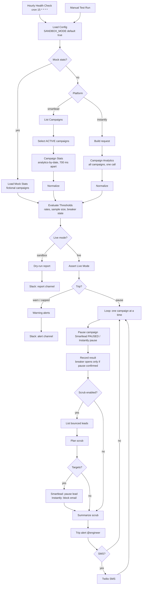
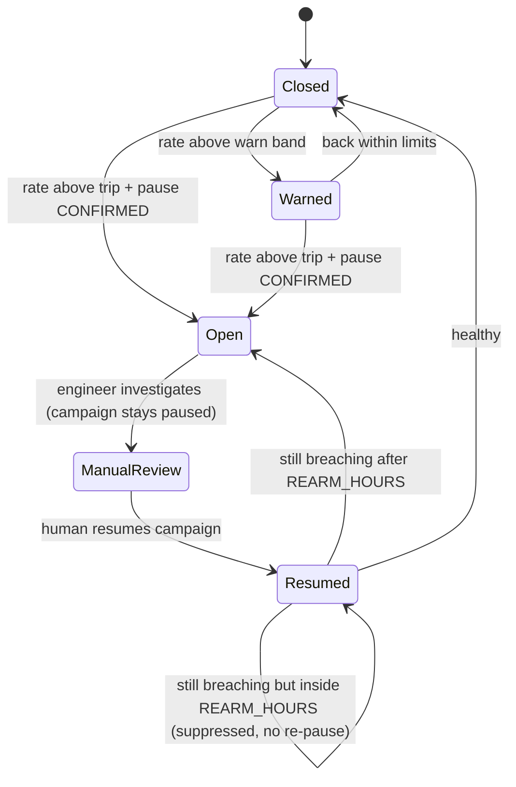

# n8n Outbound Campaign Bounce-Threshold Circuit Breaker

[](LICENSE)
[](https://github.com/dhrobinsystems/n8n-outbound-campaign-bounce-threshold-circuit-breaker/actions/workflows/ci.yml)
[](https://n8n.io)
[](package.json)

**A deliverability watchdog that pulls the plug before your domains burn.** Every hour, this n8n workflow pulls campaign health stats from **Smartlead** or **Instantly** and calculates bounce, spam-complaint and unsubscribe rates over a rolling window. When a campaign's bounce rate **exceeds 3%**, or its spam-complaint rate crosses the safety threshold, it acts as a **circuit breaker**: it **pauses the campaign**, **scrubs bounced leads** from active sequences, and **pages your deliverability engineer** on Slack, or by SMS through Twilio.

Built and maintained by **DH Robin** ([dhRobin Systems](https://dhrobinsystems.com), `dhrobinsystems`).

---

## Table of contents

- [Flow diagram](#flow-diagram)
- [Threshold logic](#threshold-logic)
- [Circuit-breaker states](#circuit-breaker-states)
- [Node-by-node reference](#node-by-node-reference)
- [Safety rails](#safety-rails)
- [Setup](#setup)
- [Environment variables](#environment-variables)
- [Developer workflow](#developer-workflow)
- [Limitations & extensions](#limitations--extensions)
- [Disclaimer](#️-disclaimer--liability-limitation)
- [License](#license)

---

## Flow diagram



---

## Threshold logic

All maths lives in [`src/thresholdValidator.js`](src/thresholdValidator.js) and is unit-tested.

| Metric | Formula | Warn (alert only) | Trip (pause + scrub + page) |
| --- | --- | --- | --- |
| Bounce rate | `bounced / denominator × 100` | > 2% | **> 3%** |
| Spam-complaint rate | `complaints / denominator × 100` | > 0.1% | **> 0.3%** |
| Unsubscribe rate | `unsubscribed / denominator × 100` | > 2% | never trips |

- **Denominator:** unique leads contacted when the platform reports them (bounces are counted per lead), otherwise emails sent. Each alert says which one was used.
- **"Exceeds" means strictly greater than.** At exactly 3.00% the campaign warns. At 3.01% it trips.
- **Minimum sample:** campaigns are only judged after `MIN_SENT_FOR_EVALUATION` (default 100) contacts in the window. One bounce out of ten sends never pauses a campaign.
- **Rolling window:** `LOOKBACK_DAYS` (default 7, UTC, inclusive). Recent problems surface quickly, while old history doesn't mask a new bad list.
- **Exact maths:** rates are computed with integer arithmetic and rounded to 2 decimals, so `3/100` is exactly `3.00`.
- **Missing data is never "healthy":** if an active campaign's bounce count is missing or the stats call fails, the result is a warning, never `ok`.
- **Spam data:** the Smartlead and Instantly analytics responses used here do not document a spam-complaint field. The validator applies the spam thresholds whenever a count is present (auto-detected names, or `SPAM_COUNT_FIELD`). See [Limitations](#limitations--extensions).

---

## Circuit-breaker states



- The breaker opens **only after the platform confirms the pause**. A failed pause produces an "AUTO-PAUSE FAILED, pause manually now" alert, and the next run tries again.
- Paused campaigns aren't evaluated, so there is no alert spam while the engineer works.
- A human resume is respected for `REARM_HOURS`. After that, a campaign that is still unhealthy is paused again.
- Warnings repeat at most once per `WARN_REALERT_HOURS`.
- State lives in n8n **workflow static data**, which is persisted for production (scheduled) executions only, not manual test runs.

---

## Node-by-node reference

| Node | Purpose |
| --- | --- |
| **Hourly Health Check (Cron)** | `15 * * * *`. Edit the expression to change the cadence. |
| **Manual Test Run** | Rehearsals with `MOCK_STATS=true`. |
| **Load Config** | Validates all variables and fails fast. Emits a redacted config. |
| **Mock Stats? → Load Mock Stats** | Fictional campaigns covering trip, warn, too-small, paused and completed cases. |
| **Smartlead: List Campaigns → Select Active → Campaign Stats → Normalize** | `GET /campaigns/`, then `GET /campaigns/{id}/analytics-by-date` per active campaign, 700 ms apart, with retries. |
| **Build Instantly Stats Request → Campaign Analytics → Normalize** | One `GET /api/v2/campaigns/analytics` call returns every campaign, including its status. |
| **Evaluate Thresholds** | Rates, sample-size gate, scope lists, breaker state, severity ordering, `MAX_PAUSES_PER_RUN`. |
| **Live Mode?** | Fail-safe gate: only `mode === "live"` continues to pausing, scrubbing and paging. |
| **Build/Post Dry-Run Report** | Sandbox: what *would* happen, even when nothing breached. |
| **Assert Live Mode** | Re-reads the environment and halts if sandbox or mock mode is on. |
| **Build Warning Alerts → Slack** | Warn-band breaches and capped pauses. |
| **Loop Over Breached Campaigns** | One campaign per iteration. |
| **Pause via Smartlead/Instantly** | Smartlead `POST /campaigns/{id}/status {"status":"PAUSED"}` (never `STOPPED`, which is permanent). Instantly `POST /api/v2/campaigns/{id}/pause`. |
| **Record Pause Result** | Opens the breaker only on a confirmed pause and builds the scrub query. |
| **List Bounced Leads → Plan Lead Scrub** | Smartlead `GET /campaigns/{id}/leads?emailStatus=is_bounced&status=INPROGRESS`. Instantly `POST /api/v2/leads/list` with `FILTER_VAL_BOUNCED`, then `FILTER_VAL_RISKY` (optional), cursor-paged across runs. |
| **Pause Bounced Lead / Block Bounced Email** | Smartlead `POST /campaigns/{id}/leads/{lead_id}/pause`. Instantly `POST /api/v2/block-lists-entries`. |
| **Summarize Scrub → Build Trip Alert → Slack → SMS** | @-mentions the engineer. The SMS carries the campaign ID and rates only. |

---

## Safety rails

- **`SANDBOX_MODE=true` by default.** Evaluation only, plus a dry-run report. Typos keep sandbox on.
- **`MOCK_STATS=true` is rejected unless sandbox is on**, so fictional data can never pause a real campaign.
- **Static sandbox proof:** `npm run check` walks the workflow graph and fails if any pause, scrub or paging node can run without the live gate.
- **Pause, never stop:** Smartlead `STOPPED` is permanent and is never used.
- **Per-run pause cap** (`MAX_PAUSES_PER_RUN`): a bad data day can't silently pause everything. Extra breaches are alerted for manual action.
- **Rate-limit awareness:** stats, scrub and alert calls are batched (one request every 700 ms), GET and pause calls retry up to 3 times with a 5 s back-off, and scrubbing is paged (`SCRUB_PAGE_SIZE`) across runs.
- **Path-injection guard:** campaign and lead IDs are validated before they are put into URLs.
- **The workflow ships inactive**, credentials are `REPLACE_WITH_YOUR_CREDENTIAL_ID`, and samples use fictional campaigns on reserved `example.*` domains.

---

## Setup

1. **n8n host:** set the variables from [`.env.example`](.env.example) plus `N8N_BLOCK_ENV_ACCESS_IN_NODE=false`. Keep `SANDBOX_MODE=true` and set `MOCK_STATS=true` for the first run.
2. **Import:** in n8n, open **Workflows → Import from File** and choose `workflow.json`.
3. **Credentials**, selected on every flagged node:
   - **Smartlead:** *Query Auth* credential, name `api_key`, value = your Smartlead API key.
   - **Instantly:** *Header Auth* credential, name `Authorization`, value `Bearer <API key>`. The key needs campaign read/update, lead read and block-list create scopes.
   - **Slack:** *Slack API* credential (bot token with `chat:write`). Invite the bot to the alert and report channels.
   - **Twilio (optional):** *Basic Auth* credential, user = Account SID, password = Auth Token.
4. **Rehearse:** click **Manual Test Run** and review the **SANDBOX DRY RUN** report.
5. **Real data, still sandbox:** set `MOCK_STATS=false` and confirm the report matches your platform's dashboard numbers.
6. **Go live:** set `SANDBOX_MODE=false`, restart n8n, and **activate** the workflow. Breaker state is only kept for scheduled (production) runs.

Run `npm run evaluate` to see offline how your thresholds would treat the mock data, or a saved API response.

---

## Environment variables

| Variable | Default | Description |
| --- | --- | --- |
| `SANDBOX_MODE` | `true` | Evaluate and report only. |
| `MOCK_STATS` | `false` | Use built-in fictional stats (sandbox only). |
| `PLATFORM` | `smartlead` | `smartlead` or `instantly`. |
| `LOOKBACK_DAYS` | `7` | Rolling evaluation window. |
| `MIN_SENT_FOR_EVALUATION` | `100` | Minimum sample before judging. |
| `BOUNCE_RATE_TRIP_PERCENT` / `_WARN_PERCENT` | `3` / `2` | Bounce thresholds. |
| `SPAM_RATE_TRIP_PERCENT` / `_WARN_PERCENT` | `0.3` / `0.1` | Spam-complaint thresholds. |
| `UNSUBSCRIBE_RATE_WARN_PERCENT` | `2` | Early-warning signal. |
| `SPAM_COUNT_FIELD` | *(auto)* | Dotted path to a complaint count. |
| `REARM_HOURS` | `24` | Respect a manual resume for this long. |
| `WARN_REALERT_HOURS` | `24` | Warning repeat interval. |
| `MAX_PAUSES_PER_RUN` | `25` | Cap on automatic pauses per run. |
| `CAMPAIGN_ALLOWLIST` / `CAMPAIGN_DENYLIST` | *(empty)* | Scope control by campaign ID. |
| `SCRUB_LEADS` / `SCRUB_INCLUDE_RISKY` / `SCRUB_PAGE_SIZE` | `true` / `false` / `100` | Lead scrubbing. |
| `SLACK_ALERT_CHANNEL` | `#deliverability-alerts` | Channel ID, `#name`, or user ID (DM). |
| `DELIVERABILITY_ENGINEER_SLACK_ID` | *(empty)* | @-mentioned on alerts. |
| `SLACK_REPORT_CHANNEL` | alert channel | Sandbox reports. |
| `SMS_ENABLED`, `TWILIO_ACCOUNT_SID`, `TWILIO_FROM_NUMBER`, `ONCALL_SMS_NUMBER` | off | Optional SMS paging. |

---

## Developer workflow

```bash
git clone https://github.com/dhrobinsystems/n8n-outbound-campaign-bounce-threshold-circuit-breaker.git
cd n8n-outbound-campaign-bounce-threshold-circuit-breaker
npm test            # zero dependencies, no network
npm run evaluate    # offline verdicts for the mock campaigns
npm run evaluate -- smartlead samples/smartlead-analytics-by-date.example.json
npm run build       # compile src/*.js into the workflow Code nodes
npm run check       # sync, credentials, secrets, sandbox-gate proof
```

```
├── workflow.json                 # importable n8n workflow (generated regions + node glue)
├── src/
│   ├── thresholdValidator.js     # rate maths, evaluation, breaker state, run planning
│   ├── platforms.js              # Smartlead & Instantly request builders / parsers
│   ├── alerts.js                 # Slack Block Kit alerts, dry-run report, SMS text
│   ├── config.js                 # env parsing & validation
│   └── mockStats.js              # fictional campaigns for MOCK_STATS
├── scripts/                      # build-workflow.js (build + --check), evaluate-stats.js
├── tests/                        # node --test, incl. a harness that runs workflow Code nodes
├── samples/                      # fictional API responses (example.* domains only)
└── .github/workflows/ci.yml      # Node 20 & 22: test, check, build drift
```

---

## Limitations & extensions

- **Spam complaints:** the campaign analytics endpoints used here don't document a complaint count. Spam thresholds apply only when one is present. For real complaint data, feed Google Postmaster Tools (domain spam rate) or your ESP's feedback loops into the stats, for example with an extra node that adds `spam_count`, then set `SPAM_COUNT_FIELD`.
- **API field names** can vary by account and API version. The normalizers accept the documented variants. Always compare a sandbox report against your dashboard before going live.
- **Instantly scrubbing adds addresses to the workspace block list,** which affects every campaign. Set `SCRUB_LEADS=false` if you'd rather review them manually.
- **Platform-native protection:** Smartlead has its own bounce auto-pause feature. This workflow complements it with cross-platform rules, spam thresholds, lead scrubbing and paging.

---

## ⚠️ Disclaimer & Liability Limitation

Use at your own risk. The code, workflows, and scripts provided in this repository (`n8n-outbound-campaign-bounce-threshold-circuit-breaker`) are for educational and architectural demonstration purposes.

- **No Liability:** The author and dhRobin Systems assume no responsibility or liability for any direct, indirect, incidental, or consequential damages resulting from the use, misuse, or deployment of these scripts.
- **No Warranty:** All software, configuration templates, and JavaScript modules are provided "AS IS" without warranty of any kind, express or implied, including but not limited to merchantability, fitness for a particular purpose, or non-infringement.
- **Production Testing Required:** Always test thoroughly in an isolated staging environment with mock campaign data before connecting live Smartlead, Instantly, or CRM credentials.
- **Third-Party APIs & Compliance:** Users are solely responsible for complying with the terms of service, rate limits, data privacy regulations (GDPR/CCPA), anti-spam laws (e.g. CAN-SPAM, CASL, PECR), and security policies of Smartlead, Instantly, Slack, Twilio, and any connected CRM, including verifying every automated pause and lead suppression.

> The full disclaimer is also available in [DISCLAIMER.md](DISCLAIMER.md).

---

## License

Released under the MIT License. Copyright (c) 2026 DH Robin (dhRobin Systems). See [LICENSE](LICENSE).
